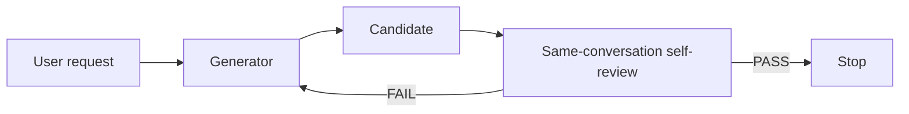
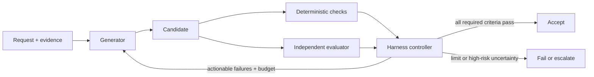
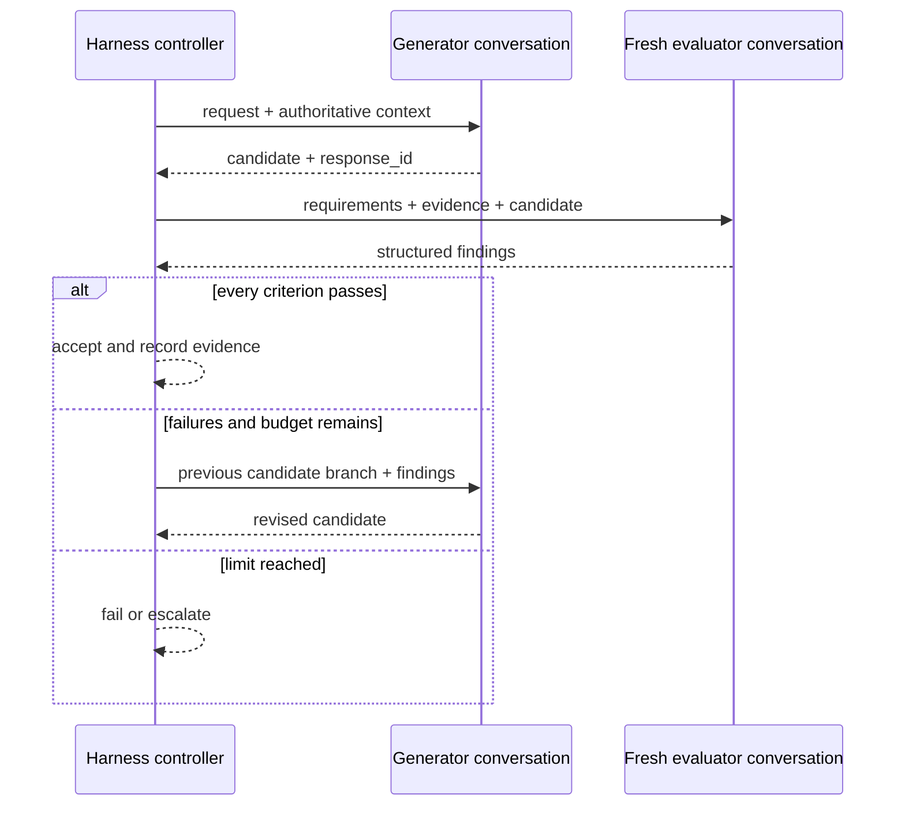
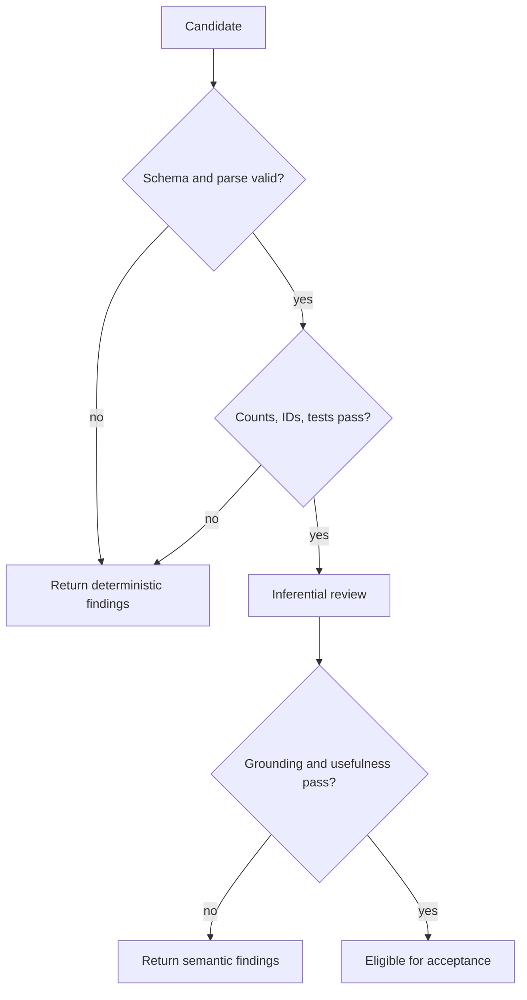
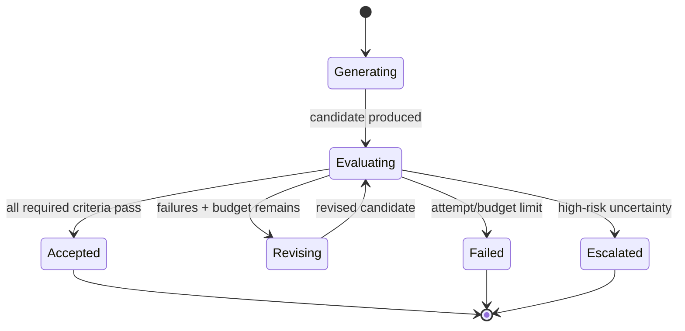
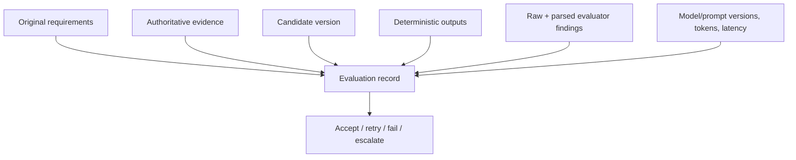

# Architecture Diagrams

These Mermaid sources are editable references. Recreate them in the course's
native diagram system for final slides if Mermaid rendering is not supported.

## 1. Weak same-conversation acceptance

**Teaching note:** The diagram does not claim that self-review always passes.
It shows that generation and the only acceptance signal share one conversation.

## 2. Generator–evaluator–controller separation

**Teaching note:** Feedback returns through controller policy. The evaluator
does not directly command acceptance or invoke the generator.

## 3. Conversation branches

## 4. Layered checks

**Accuracy note:** Some systems may batch checks differently for latency. This
is the recommended default when early exact failures can avoid model cost.

## 5. Runtime state machine

## 6. Evidence model

**Privacy note:** Store decision-relevant inputs and outputs under the product's
data policy. Do not request or retain private chain-of-thought.
