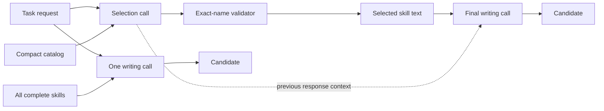
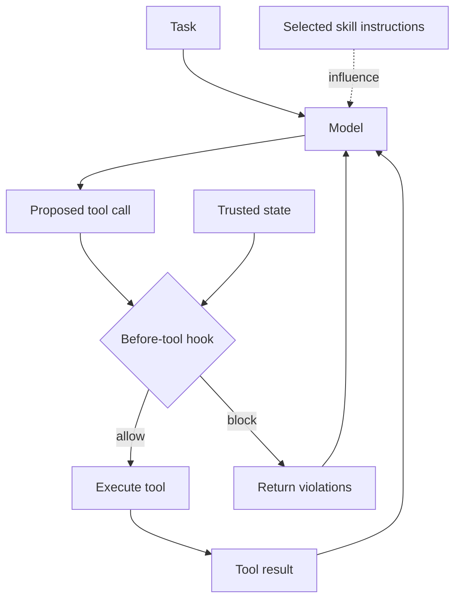
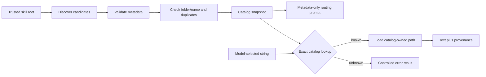
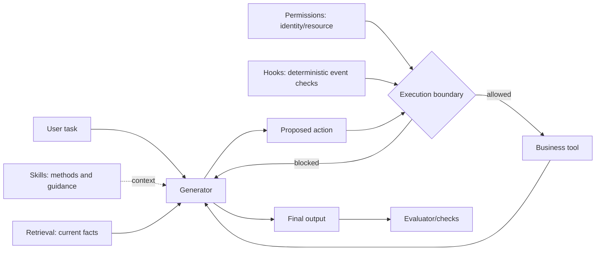
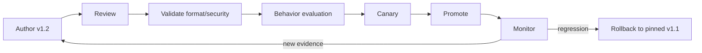

# Architecture Diagrams

These Mermaid diagrams are editable references for slide production. Rebuild
them in the course visual system rather than relying on Mermaid screenshots.

## Eager and on-demand serving paths



## Skill versus hook



## Discovery and resolution boundary



## Bounded two-cycle loop

```mermaid
sequenceDiagram
    participant H as Harness
    participant M as Model
    participant C as Trusted catalog

    H->>M: Cycle 1: task + metadata + load_skill
    M-->>H: zero or more function_call items
    loop Each proposed call, up to configured limit
        H->>H: Parse and validate name/arguments
        H->>C: Exact-name lookup
        C-->>H: Skill text + provenance, or error
    end
    H->>M: Cycle 2: correlated outputs; no loader
    M-->>H: Final artifact
    H->>H: Evaluate and record serving metrics
```

## Responsibility boundaries



## Versioned skill lifecycle


