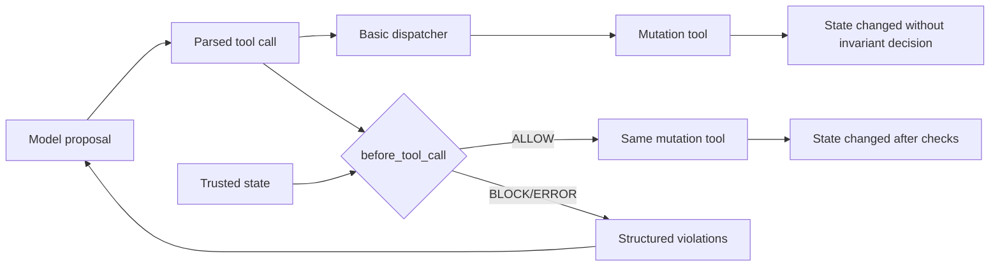
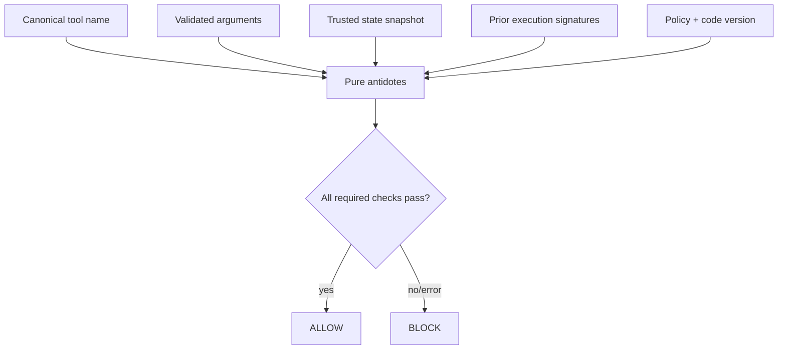
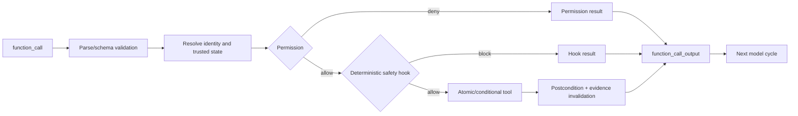
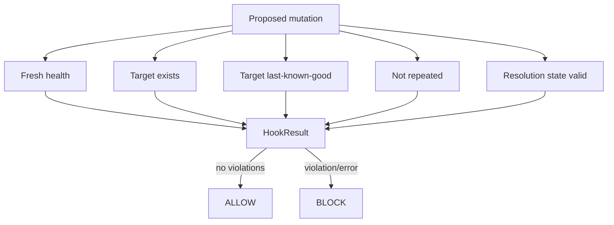
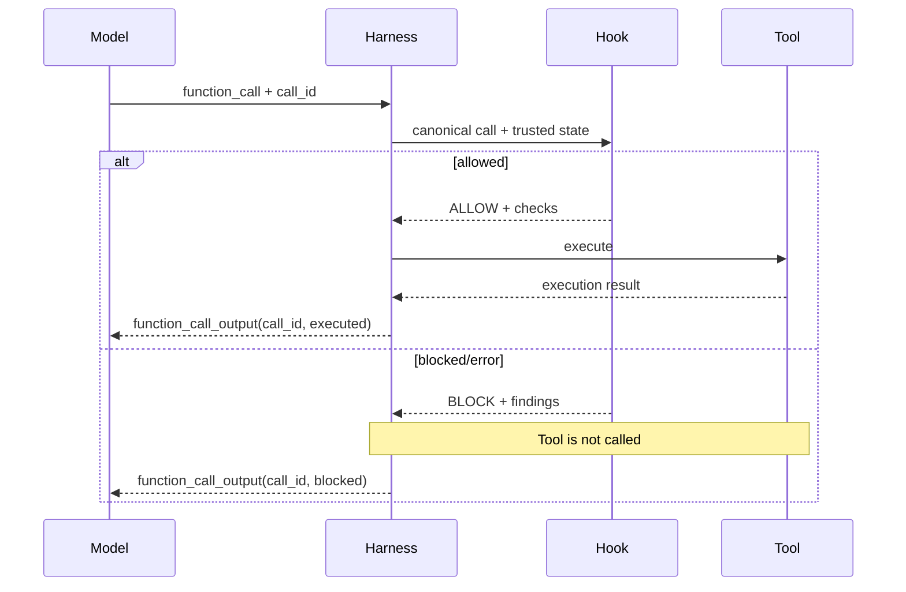

# Architecture Diagrams

These Mermaid diagrams are editable references for slide production. Rebuild
them in the course visual language instead of using raw screenshots.

## Basic versus hook-protected execution



## Deterministic hook decision



## Cumulative control order



## Incident antidote composition



## Evidence invalidation and replay

```mermaid
sequenceDiagram
    participant M as Model
    participant H as Harness/hook
    participant T as Mutation tool
    participant S as State store

    M->>H: request mutation(signature K)
    H->>S: read state v17 + fresh evidence
    H->>H: antidotes PASS; K unseen
    H->>T: execute with expected state v17 + idempotency K
    T->>S: conditional write v17 -> v18; record K
    S-->>T: success
    T-->>H: executed
    H->>H: invalidate health evidence
    M->>H: retry mutation(signature K)
    H->>H: replay antidote BLOCKS
    H-->>M: already executed / blocked result
```

## Check/use race and conditional fix

```mermaid
sequenceDiagram
    participant H as Hook
    participant A as Other actor
    participant S as Shared state
    participant T as Tool

    H->>S: read/check version 17
    S-->>H: invariant passes
    A->>S: update to version 18
    H->>T: execute expecting version 17
    T->>S: conditional write if version == 17
    S-->>T: conflict; no write
    T-->>H: stale-state failure
```

## Hook result feedback loop


