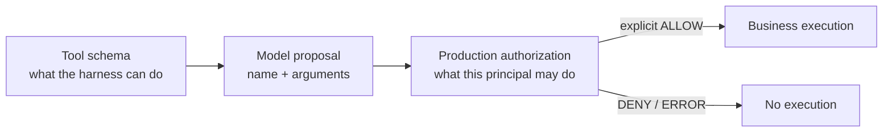
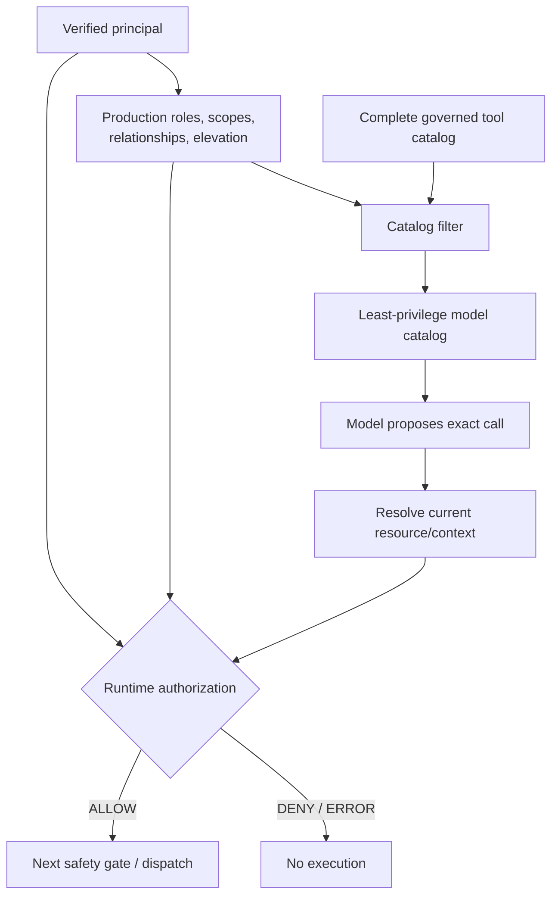
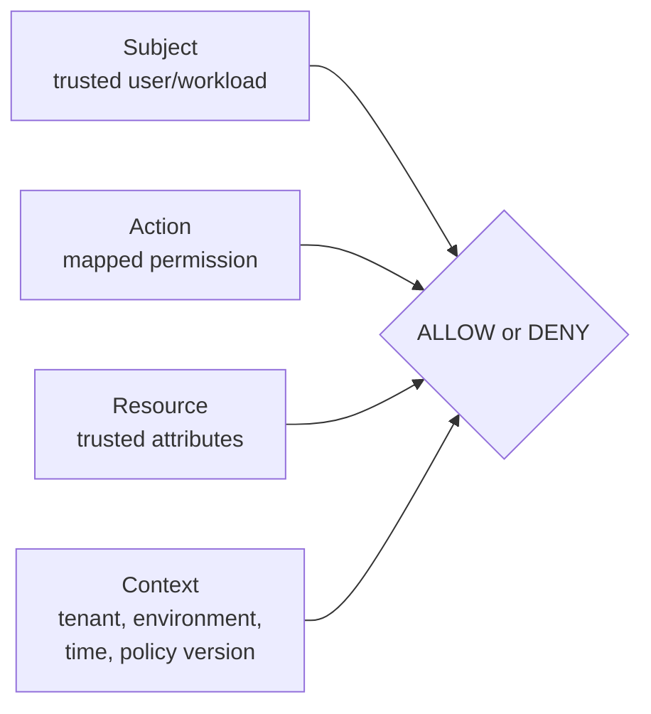
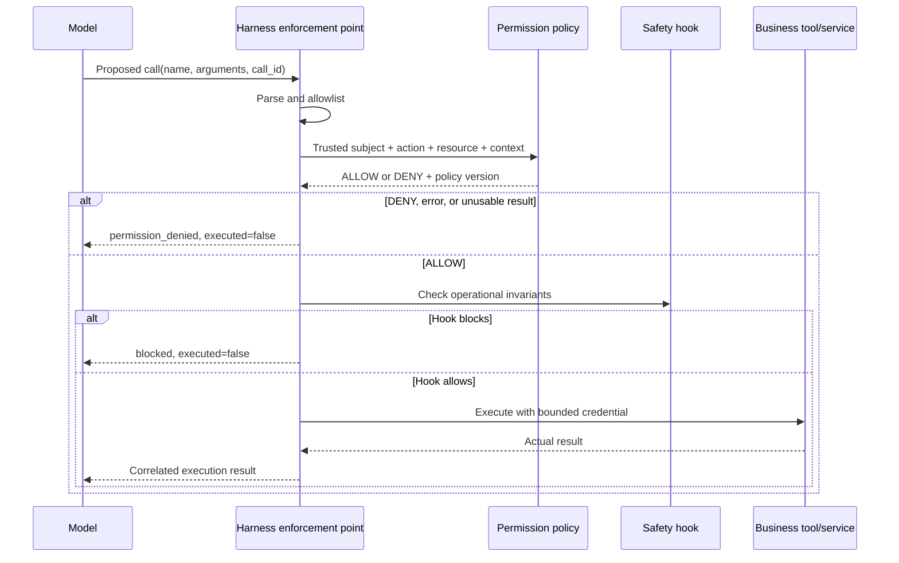
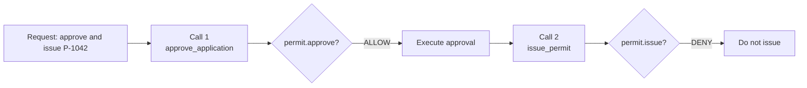
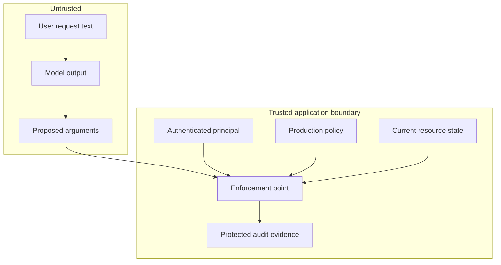

# Architecture Diagrams

These Mermaid sources are production references. Redraw them in the course
visual system rather than relying on Mermaid defaults in final video.

## 1. Capability is not authority

**Use:** Video 1.  
**Required label:** A proposal is not a side effect.

## 2. Permission-derived catalog plus runtime enforcement

**Use:** Videos 2 and 3.  
**Required annotation:** Filtering narrows opportunity; runtime authorization
enforces authority.

## 3. Subject-action-resource-context decision

**Use:** Video 3.  
**Do not show:** Prompt text feeding role, owner, tenant, or approval fields.

## 4. Decision and enforcement separation

**Use:** Video 4.  
**Vocabulary:** The harness is the policy enforcement point in this course.
The policy code or service is the decision point.

## 5. Independent multi-action authorization

**Use:** Videos 3 and 5.  
**Required final-state label:** `P-1042 = APPROVED`, not `PERMIT_ISSUED`.

## 6. Trust boundaries

**Use:** Throughout.  
**Accessibility:** Do not encode trust only by color; use boundary labels and
solid versus dashed line styles.
