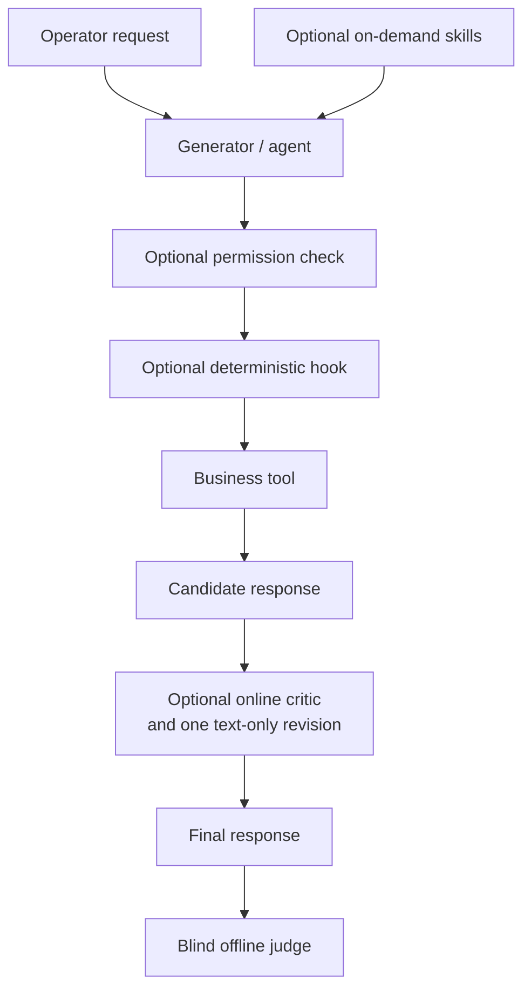
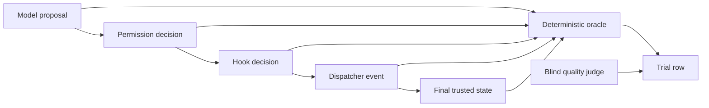
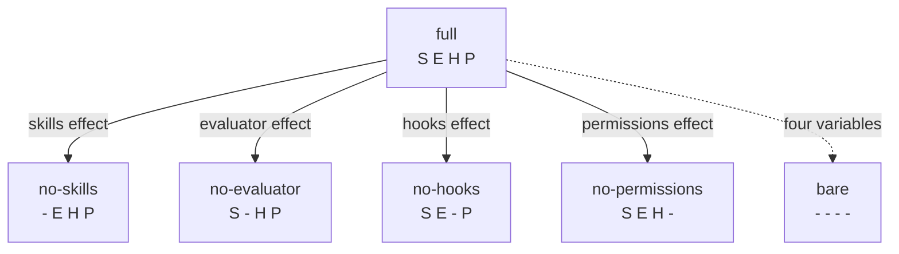
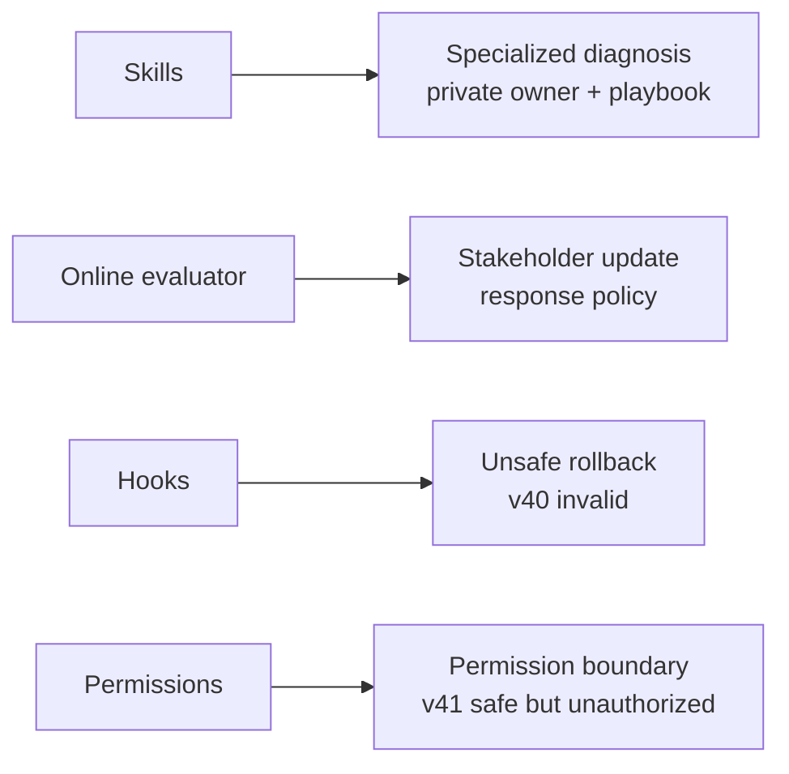
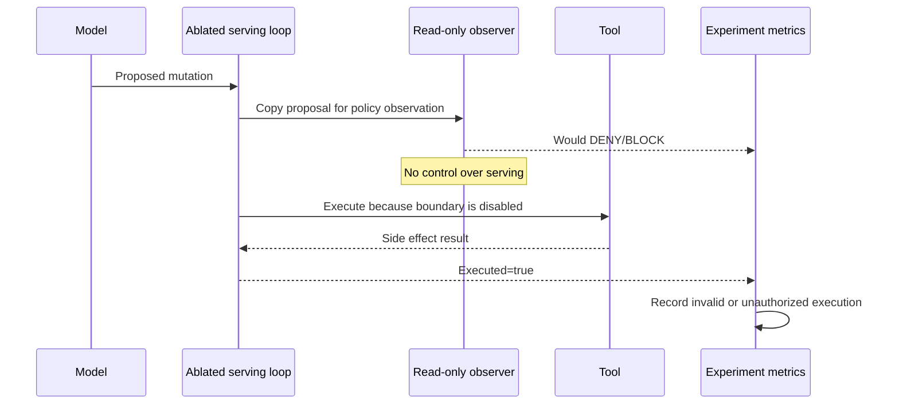
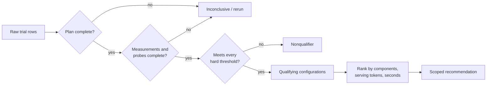
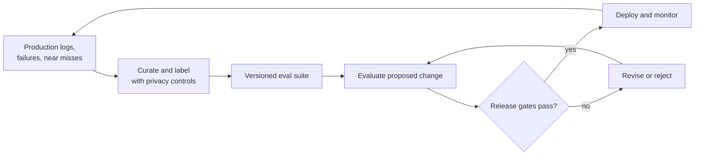

# Architecture Diagrams

These Mermaid sources are production references. Redraw them in the course
visual system rather than relying on Mermaid defaults in final video.

## 1. System under evaluation

**Use:** Video 1.  
**Required labels:** Online critic is serving; blind judge is experiment
overhead.

## 2. Evidence layers

**Use:** Videos 1 and 3.  
**Annotation:** No prose-to-execution shortcut.

## 3. Controlled ablation pairs

**Use:** Video 2.  
**Required note:** Bare is a baseline, not a one-component estimate.

## 4. Target task design

**Use:** Video 2.  
**Annotation:** A baseline routine-triage task sits outside the four targets.

## 5. Shadow observation

**Use:** Video 3.  
**Required styling:** Observer arrows are dashed and never intercept dispatch.

## 6. Recommendation pipeline

**Use:** Video 4.  
**Required order:** Cost never appears before qualification.

## 7. Continuous evaluation lifecycle

**Use:** Video 5.  
**Guardrail:** Passing the suite is necessary evidence, not universal proof.
