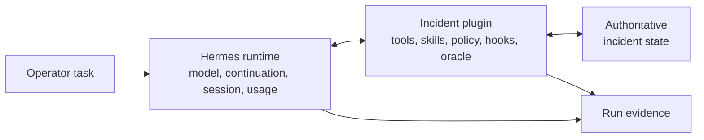
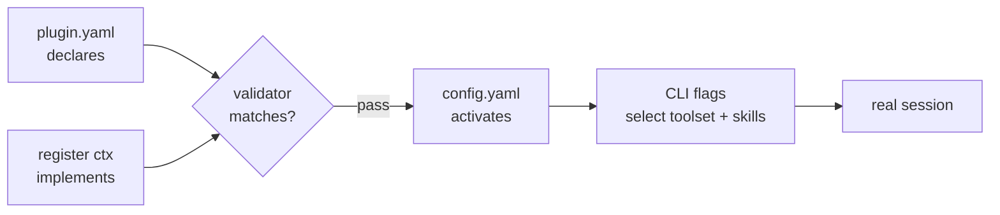
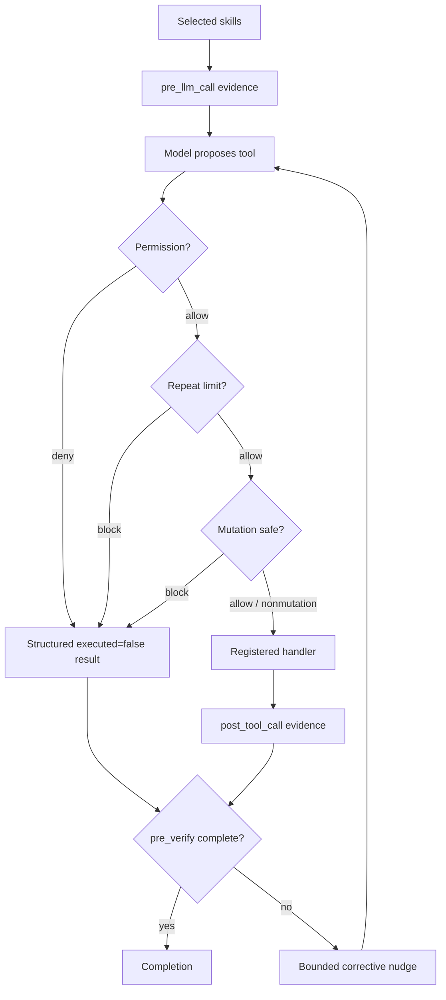
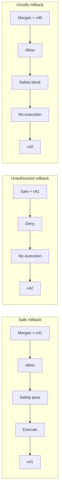
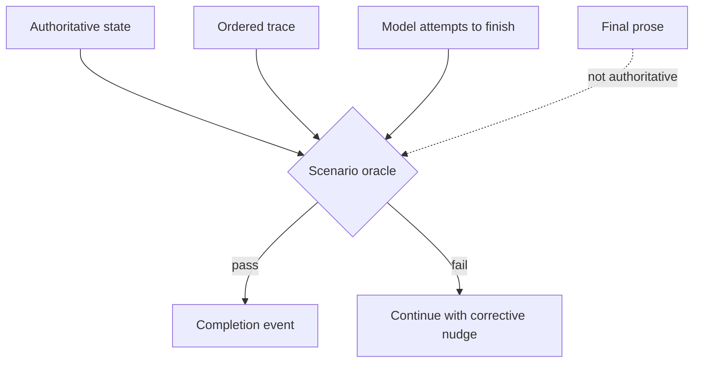
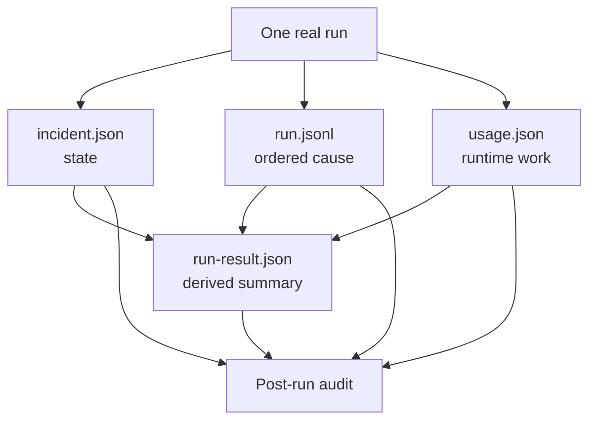
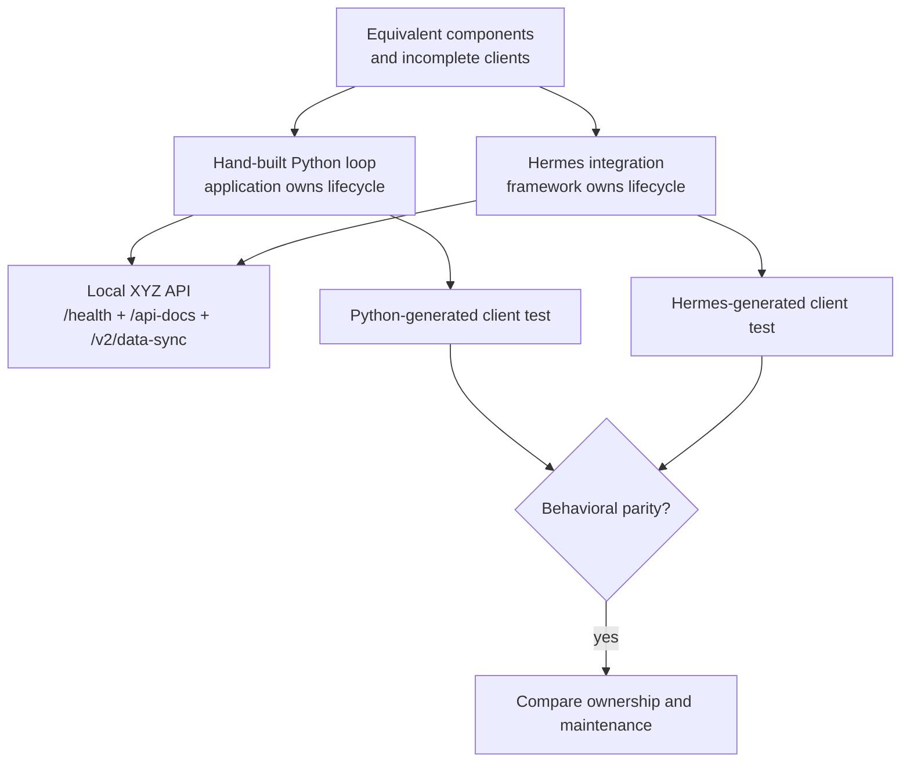
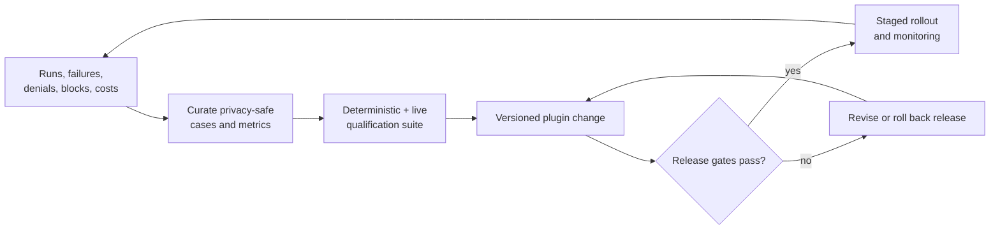

# Architecture Diagrams

These Mermaid sources are production references. Redraw them in the course
visual system rather than relying on Mermaid defaults in the final video.

## 1. Runtime ownership

**Use:** Video 1.  
**Required annotation:** `run_demo.py` prepares and invokes the runtime; it is
not a second model loop.

## 2. Package-to-session gates

**Use:** Video 2.  
**Guardrail:** Validator arrow ends before the real session; do not imply
business behavior was tested.

## 3. Production lifecycle and short circuits

**Use:** Video 3.  
**Required styling:** Deny and block paths never touch the handler. Add a
maximum-turn/verification badge to the loop from nudge to model.

## 4. Scenario proof matrix

**Use:** Videos 1 and 4.  
**Annotation:** Every lane starts from freshly prepared `checkout-v42`.

## 5. Completion evidence

**Use:** Videos 3 and 4.  
**Guardrail:** The dashed prose line must not visually override state or trace.

## 6. Evidence reconciliation

**Use:** Video 4.  
**Annotation:** Derived summary is convenient, not a replacement for source
evidence.

## 7. Exercise ownership comparison

**Use:** Video 5.  
**Guardrail:** Do not merge the two generated workspaces or imply their source
must be identical.

## 8. Operational evolution loop

**Use:** Video 5.  
**Required note:** Release rollback here is different from the incident
`rollback_deployment` tool.
